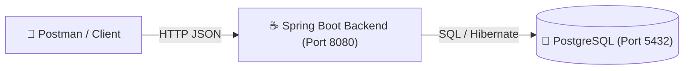
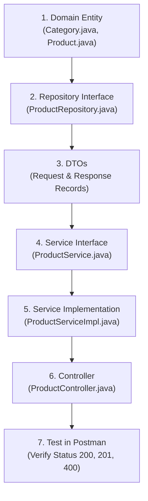
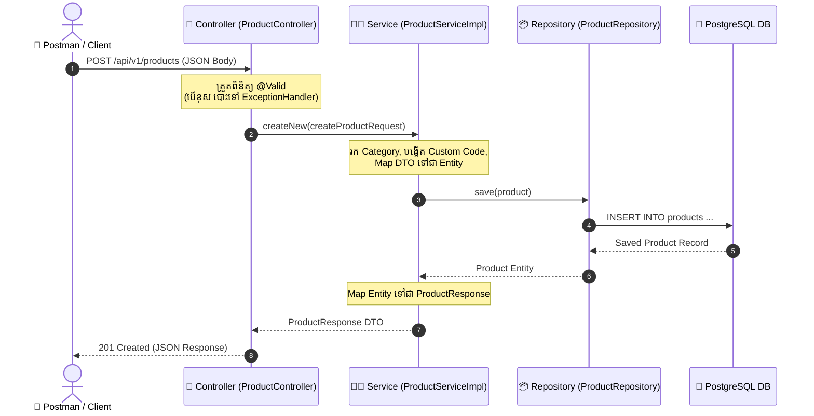
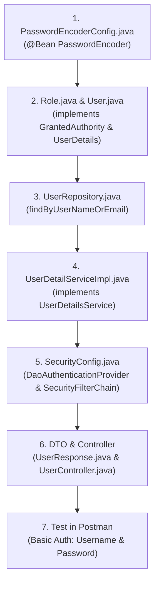

# 🚀 Spring Boot Web MVC - Master Study Notes (សៀវភៅកំណត់ត្រាមេរៀន)

> **Course:** ISTAD Year 2 - Spring Web MVC & RESTful API  
> **Topic:** Complete Architecture, Code Flow & Core Keys Cheat Sheet

---

## 📑 តារាងមាតិកា (Table of Contents)
1. [The Big Picture: What We Have Built (រូបភាពទូទៅនៃ Project)](#1-the-big-picture-what-we-have-built)
2. [Coding Workflow: The Step-by-Step Order (លំដាប់លំដោយពេលសរសេរកូដ)](#2-coding-workflow-the-step-by-step-order)
3. [Request Flow: How Data Moves (ដំណើរការនៃទិន្នន័យពេល Client ហៅ API)](#3-request-flow-how-data-moves)
4. [The 5 Core Layers Explained (ស្រទាប់ស្នូលទាំង ៥ នៃស្ថាបត្យកម្ម)](#4-the-5-core-layers-explained)
5. [The Essential Annotations Cheat Sheet (កម្រង Annotations សំខាន់ៗបំផុត)](#5-the-essential-annotations-cheat-sheet)
6. [Advanced Features Summary (លក្ខណៈពិសេសដែលបានអនុវត្ត)](#6-advanced-features-summary)
7. [Bridge to the Next Topic: Spring Security (ត្រៀមខ្លួនសម្រាប់ Spring Security)](#7-bridge-to-the-next-topic-spring-security)

---

## 1. The Big Picture: What We Have Built
យើងបានបង្កើត **E-Commerce Backend REST API** ដោយប្រើ **Spring Boot 3 + Spring Data JPA + PostgreSQL**។



### Entities in our System:
* **`categories`**: ប្រភេទផលិតផល (`eletronics`, `home`)
* **`products`**: ផលិតផលសម្រាប់លក់ (`code`, `name`, `price`, `is_available`, `category_id`)
* **`orders` & `order_lines`**: ការបញ្ជាទិញទំនិញ
* **`users`, `roles` & `user_roles`**: អ្នកប្រើប្រាស់ និងសិទ្ធិ (គ្រឹះសម្រាប់ Spring Security)

---

## 2. Coding Workflow: The Step-by-Step Order
ពេលលោកគ្រូដាក់ Assignment ឬពេលចង់បង្កើត Feature ថ្មី (ឧទាហរណ៍ Product Feature) **ត្រូវសរសេរតាមលំដាប់លំដោយ ៦ ជំហាននេះជានិច្ច**៖



1. **Step 1: Domain Entity** ➡️ កំណត់រចនាសម្ព័ន្ធ Table ក្នុង Database
2. **Step 2: Repository** ➡️ Interface សម្រាប់ទាញ និងរក្សាទុកទិន្នន័យ (Extends `JpaRepository`)
3. **Step 3: DTOs** ➡️ កំណត់ទម្រង់ Data សម្រាប់ទទួលពី Client (`Request`) និង Return ទៅវិញ (`Response`)
4. **Step 4: Service Interface** ➡️ កំណត់ឈ្មោះ Methods/Logic ដែលត្រូវធ្វើ
5. **Step 5: Service Implementation** ➡️ សរសេរ Business Logic ពិតប្រាកដ
6. **Step 6: Controller** ➡️ បង្កើត Endpoints ទទួល HTTP Requests (`GET`, `POST`, `PUT`, `PATCH`, `DELETE`)
7. **Step 7: Test in Postman** ➡️ Run Server ហើយតេស្តមើល Response

---

## 3. Request Flow: How Data Moves
ពេលយើងចុច **Send** ក្នុង Postman នេះជាដំណើរការដែលកូដធ្វើការ៖



---

## 4. The 5 Core Layers Explained

| ស្រទាប់ (Layer) | ទីតាំង (Package) | តួនាទីសំខាន់ (Responsibility) | ឧទាហរណ៍ក្នុង Project |
| :--- | :--- | :--- | :--- |
| **Domain** | `domain` | ជាកូនសោបង្កើត Database Table ដោយស្វ័យប្រវត្ត | `Product.java`, `User.java` |
| **Repository** | `repository` | ជួយ execute SQL ដោយស្វ័យប្រវត្ត (`SELECT`, `INSERT`, `UPDATE`, `DELETE`) | `ProductRepository.java` |
| **DTO** | `dto` | ការពារ Database Entity មិនឲ្យធ្លាយទៅក្រៅ (Data Security) | `CreateProductRequest.java`, `ProductResponse.java` |
| **Service** | `service` | ខួរក្បាលនៃប្រព័ន្ធ (Business Logic, ត្រួតពិនិត្យលក្ខខណ្ឌ) | `ProductServiceImpl.java` |
| **Controller** | `controller` | អ្នកទទួលភ្ញៀវ — ទទួល HTTP Request និងបោះ JSON ទៅវិញ | `ProductController.java` |
| **Exception** | `exception` | ចាប់ Error ទូទាំងប្រព័ន្ធ ហើយរៀបចំ Error JSON ឲ្យស្អាត | `AppGlobalExceptionHandler.java` |

---

## 5. The Essential Annotations Cheat Sheet

### A. JPA / Database Annotations (ក្នុង `domain`):
* `@Entity`: ប្រាប់ Spring ថា class នេះជា Database Table
* `@Table(name = "products")`: កំណត់ឈ្មោះ Table
* `@Id`: កំណត់ Primary Key
* `@GeneratedValue(strategy = GenerationType.IDENTITY)`: Auto-increment (1, 2, 3...) សាកសមសម្រាប់ Numeric types (`Integer`, `Long`)
* `@Column(nullable = false, unique = true)`: កំណត់លក្ខខណ្ឌលើ Column
* `@ManyToOne`: ទំនាក់ទំនង ច្រើនទៅមួយ (ឧទាហរណ៍៖ Product ច្រើន ស្ថិតក្នុង Category តែមួយ)
* `@OneToMany(mappedBy = "...")`: ទំនាក់ទំនង មួយទៅច្រើន
* `@ManyToMany` & `@JoinTable`: ទំនាក់ទំនង ច្រើនទៅច្រើន (User មួយមាន Role ច្រើន, Role មួយមាន User ច្រើន)

### B. Dependency Injection & Service Annotations:
* `@Service`: ប្រាប់ Spring ឲ្យគ្រប់គ្រង class នេះជា Service Bean
* `@Repository`: ប្រាប់ Spring ថាជា Data Access Bean
* `@RequiredArgsConstructor`: (របស់ Lombok) បង្កើត Constructor សម្រាប់ Inject `private final` fields ដោយស្វ័យប្រវត្ត (Dependency Injection)

### C. Controller & HTTP Annotations:
* `@RestController`: `@Controller` + `@ResponseBody` (Return ជា JSON ដោយស្វ័យប្រវត្ត)
* `@RequestMapping("/api/v1/products")`: Base URL សម្រាប់ Controller
* `@GetMapping`: ទទួល Request សម្រាប់ទាញយកទិន្នន័យ (Fetch Data)
* `@PostMapping`: ទទួល Request សម្រាប់បង្កើតទិន្នន័យថ្មី (Create Data)
* `@PutMapping("/{code}")`: ទទួល Request សម្រាប់កែប្រែទិន្នន័យទាំងមូល (Full Update)
* `@PatchMapping("/{code}")`: ទទួល Request សម្រាប់កែប្រែទិន្នន័យមួយចំណែក (Partial Update)
* `@DeleteMapping("/{code}")`: ទទួល Request សម្រាប់លុបទិន្នន័យ (Delete Data)
* `@PathVariable`: ចាប់យកតម្លៃពី URL Path (ឧ. `/products/{code}`)
* `@RequestParam`: ចាប់យក Query Parameter (ឧ. `?pageNumber=0&pageSize=5`)
* `@RequestBody`: ចាប់យក JSON Body ពី Client មកបម្លែងជា Java Object
* `@Valid`: បញ្ជាឲ្យ Spring ដំណើរការ Bean Validation

### D. Validation Annotations (ក្នុង `dto`):
* `@NotBlank(message = "...")`: មិនឲ្យទទេ ឬមានតែ space (សម្រាប់ String)
* `@NotNull(message = "...")`: មិនឲ្យតម្លៃស្មើ `null`
* `@Positive`: តម្លៃលេខត្រូវតែធំជាង 0 (សម្រាប់ Price, Qty)
* `@Size(max = 150)`: កំណត់ប្រវែងអក្សរអតិបរមា

### E. Exception Handling Annotations:
* `@RestControllerAdvice`: បង្កើត Global Interceptor សម្រាប់ចាប់គ្រប់ Exception ក្នុង App
* `@ExceptionHandler(MethodArgumentNotValidException.class)`: កំណត់ method សម្រាប់ចាប់ Error ពេល validation ធ្លាក់

---

## 6. Advanced Features Summary

### 1. Pagination (ការចែកទំព័រទិន្នន័យ):
* **Concept:** ប្រើ `Pageable` និង `PageRequest.of(pageNumber, pageSize, Sort)`
* **Code Example:**
  ```java
  Pageable pageable = PageRequest.of(pageNumber, pageSize, Sort.by("name").ascending());
  Page<Product> productPage = productRepository.findAll(pageable);
  return productPage.map(productMapper::productToProductResponse);
  ```

### 2. Custom Product Code Generation:
* បង្កើត Custom Code ដូចលោកគ្រូ (`ISTAD-PRO-xxxxx`):
  ```java
  int randomNumber = new java.util.Random().nextInt(90000) + 10000;
  product.setCode("ISTAD-PRO-" + randomNumber);
  ```

### 3. JPA Derived Query Methods:
* គ្រាន់តែដាក់ឈ្មោះ Method ឲ្យត្រូវតាម Pattern នោះ Spring Data JPA នឹងបង្កើត SQL ឲ្យដោយស្វ័យប្រវត្ត៖
  ```java
  Page<Product> findByNameContainingIgnoreCaseAndIsAvailableTrue(String name, Pageable pageable);
  ```
  *(ស្មើនឹង SQL: `WHERE LOWER(name) LIKE '%name%' AND is_available = true`)*

## 7. Spring Security Master Guide (មេរៀនសង្ខេប Spring Security ពេញលេញ)

> [!IMPORTANT]
> **Spring Security** គឺជា Module ការពារសុវត្ថិភាពដ៏រឹងមាំបំផុតរបស់ Spring Framework។ ខាងក្រោមនេះជាសេចក្ដីសង្ខេបស្ថាបត្យកម្ម លំហូរកូដ និងចំណុចសំខាន់ៗដែលអ្នកត្រូវចងចាំសម្រាប់ប្រឡង និងអនុវត្តគម្រោងពិតប្រាកដ។

---

### 7.1 Core Security Concepts (គោលគំនិតគ្រឹះ ២ យ៉ាង)

| Concept | សំណួរស្នូល (Core Question) | អត្ថន័យ | HTTP Error កើតឡើងពេលបរាជ័យ |
| :--- | :--- | :--- | :--- |
| **Authentication** | **"Who are you?"** (តើអ្នកជានរណា?) | ការផ្ទៀងផ្ទាត់អត្តសញ្ញាណ (Username & Password) ថាគណនីនេះពិតជាមានមែនឬអត់ | **`401 Unauthorized`** |
| **Authorization** | **"What can you do?"** (តើអ្នកមានសិទ្ធិធ្វើអ្វី?) | ការត្រួតពិនិត្យសិទ្ធិ (Role: `ADMIN`, `BUSINESS`, `CUSTOMER`) ថាតើអាចហៅ Endpoint នោះបានឬទេ | **`403 Forbidden`** |

---

### 7.2 Spring Security Architecture & Request Flow (ដំណើរការលំហូរទិន្នន័យ)

ពេល Client (Postman) ផ្ញើ Request មកកាន់ Server ដោយភ្ជាប់ **Basic Auth (Username & Password)** នេះជាដំណើរការពីមួយជំហានទៅមួយជំហាន៖

```mermaid
sequenceDiagram
    autonumber
    actor Client as 🚀 Postman / Client
    participant Filter as 🛡️ SecurityFilterChain
    participant AuthProvider as ⚙️ DaoAuthenticationProvider
    participant UserDetailsSvc as 🔍 UserDetailServiceImpl
    participant UserRepo as 📦 UserRepository
    participant DB as 🐘 PostgreSQL DB
    participant Encoder as 🔐 BCryptPasswordEncoder
    participant Context as 🧠 SecurityContextHolder
    participant Controller as 🤵 UserController

    Client->>Filter: GET /api/v1/users/me (Header: Basic Auth)
    Filter->>AuthProvider: ផ្ញើ Username & Raw Password ទៅផ្ទៀងផ្ទាត់
    AuthProvider->>UserDetailsSvc: loadUserByUsername(username)
    UserDetailsSvc->>UserRepo: findByUserNameOrEmail(username, username)
    UserRepo->>DB: SELECT * FROM users WHERE user_name = ?
    DB-->>UserRepo: Return User Entity
    UserRepo-->>UserDetailsSvc: User Object (implements UserDetails)
    UserDetailsSvc-->>AuthProvider: Return UserDetails
    
    AuthProvider->>Encoder: matches(rawPassword, encryptedPassword)
    Note over Encoder: ផ្ទៀងផ្ទាត់ Password '12345678'<br/>ជាមួយ BCrypt Hash ($2a$10$...)
    
    alt Password ត្រូវគ្នា (Success)
        Encoder-->>AuthProvider: true
        AuthProvider->>Context: រក្សាទុក Authentication (Principal = User, Roles)
        Context->>Controller: អនុញ្ញាតឱ្យចូលដល់ Method getMe(Authentication auth)
        Note over Controller: User user = (User) auth.getPrincipal();<br/>Build UserResponse DTO
        Controller-->>Client: 200 OK (User Profile & Roles JSON)
    else Password ឬ Username ខុស (Failed)
        Encoder-->>AuthProvider: false
        AuthProvider-->>Filter: Throw BadCredentialsException
        Filter-->>Client: 401 Unauthorized
    end
```

---

### 7.3 Step-by-Step Implementation Workflow (លំដាប់លំដោយ ៧ ជំហានពេលសរសេរកូដ)

ពេលបង្កើតមុខងារ Security ក្នុងគម្រោង Spring Boot 3 ត្រូវសរសេរតាមលំដាប់នេះជានិច្ច៖



1. **Step 1: `PasswordEncoderConfig.java`**
   * បង្កើត `@Bean public PasswordEncoder passwordEncoder()` ដោយ return `new BCryptPasswordEncoder()`។
2. **Step 2: `Role.java` & `User.java` (Domain Entity)**
   * `Role` ត្រូវតែ `implements GrantedAuthority` (Override `getAuthority()` ➡️ return `"ROLE_" + this.name;`)
   * `User` ត្រូវតែ `implements UserDetails` (Override `getUsername()`, `getPassword()`, `getAuthorities()`)
3. **Step 3: `UserRepository.java`**
   * បង្កើត Method `Optional<User> findByUserNameOrEmail(String userName, String email);`
4. **Step 4: `UserDetailServiceImpl.java`**
   * ដាក់ `@Service` និង `implements UserDetailsService`
   * Override `loadUserByUsername(String username)` ដើម្បីទាញយក User ពី Database តាមរយៈ `UserRepository`
5. **Step 5: `SecurityConfig.java`**
   * ដាក់ `@Configuration` និង `@EnableWebSecurity`
   * បង្កើត `@Bean DaoAuthenticationProvider` (ផ្គុំ `UserDetailsService` និង `PasswordEncoder` បញ្ចូលគ្នា)
   * បង្កើត `@Bean SecurityFilterChain` (កំណត់ Security Firewall: Endpoint Authorization, Stateless Session, HttpBasic, Disable CSRF)
6. **Step 6: DTO & Controller**
   * បង្កើត `UserResponse.java` ជា Java Record ដោយដាក់ `@Builder`
   * បង្កើត `UserController.java` ជាមួយ `@GetMapping("/me")` ទាញទិន្នន័យពី `(User) auth.getPrincipal()`
7. **Step 7: Test with Postman**
   * ប្រើ `Basic Auth` វាយ Username & Password ➡️ ទទួលបាន `200 OK`

---

### 7.4 Essential Classes & Annotations Cheat Sheet (កម្រង Annotations & Classes ដែលត្រូវតែចាំ ⚠️)

| Annotation / Class | តួនាទីសំខាន់ (Role & Function) | ទីតាំងប្រើប្រាស់ |
| :--- | :--- | :--- |
| **`@EnableWebSecurity`** | បើកដំណើរការប្រព័ន្ធ Web Security របស់ Spring Boot | នៅលើ `SecurityConfig` |
| **`@Configuration`** | ប្រាប់ Spring ថា class នេះផ្ទុក `@Bean` definitions | នៅលើ Config classes |
| **`@Bean`** | បង្កើត Object ឱ្យ Spring IoC Container គ្រប់គ្រង | លើ methods ក្នុង Config |
| **`PasswordEncoder`** | Interface សម្រាប់ Hash និងផ្ទៀងផ្ទាត់ Password (`BCryptPasswordEncoder`) | `PasswordEncoderConfig` |
| **`UserDetails`** | Interface តំណាងឱ្យទិន្នន័យ User របស់ Spring Security | `User.java` implements |
| **`GrantedAuthority`** | Interface តំណាងឱ្យសិទ្ធិ ឬ Role របស់ User (`ROLE_ADMIN`, ...) | `Role.java` implements |
| **`UserDetailsService`** | Core Interface សម្រាប់ទាញយក User ពី Database តាមរយៈ Username | `UserDetailServiceImpl` |
| **`DaoAuthenticationProvider`**| អ្នកសម្របសម្រួល (Provider) ផ្គូផ្គង UserDetailsService និង PasswordEncoder | Bean ក្នុង `SecurityConfig` |
| **`SecurityFilterChain`** | កំណត់ Filter គ្រប់គ្រងការការពារ Endpoints (Firewall) | Bean ក្នុង `SecurityConfig` |
| **`SessionCreationPolicy.STATELESS`** | កំណត់មិនឱ្យបង្កើត HTTP Session (សាកសមសម្រាប់ REST API) | ក្នុង `SecurityFilterChain` |
| **`httpBasic(...)`** | បើកដំណើរការ HTTP Basic Authentication | ក្នុង `SecurityFilterChain` |
| **`csrf(token -> token.disable())`** | បិទ CSRF Token (ដោយសារ REST API ជា Stateless មិនបាច់ប្រើ CSRF ទេ) | ក្នុង `SecurityFilterChain` |
| **`Authentication auth`** | ចាប់យក User Authentication បច្ចុប្បន្នដែលបាន Login | Parameter ក្នុង Controller |
| **`auth.getPrincipal()`** | ទាញយក Object `UserDetails` (Entity `User`) ដែលកំពុង Login | ក្នុង `UserController` |

---

### 7.5 Common Pitfalls & Mistakes (ចំណុចដែលសិស្សតែងតែខុស និងជួប Error ⚠️)

> [!CAUTION]
> ចំណុចទាំង ៦ នេះ ត្រូវតែប្រុងប្រយ័ត្នបំផុត ព្រោះជាប្រភពនៃ Bug ញឹកញាប់បំផុតក្នុង Spring Security៖

1. ❌ **Password ក្នុង Database ជា Plain text:**
   * បើក្នុង Database តារាង `users` អ្នកបញ្ចូល Password ធម្មតាដូចជា `12345678` នោះពេល Login នឹងធ្លាក់ **`401 Unauthorized`** ជានិច្ច ព្រោះ `BCryptPasswordEncoder` ត្រូវការទម្រង់ Hash ដែលផ្ដើមដោយ `$2a$10$...`។
2. ❌ **ច្រឡំ Database Password ជាមួយ User Login Password:**
   * Password ក្នុង `application.yaml` (`YourNewPassword123`) គឺជា Password សម្រាប់ Spring Boot ភ្ជាប់ទៅ PostgreSQL ទេ មិនមែន User Login ក្នុង Postman ឡើយ!
3. ❌ **Method `getUsername()` ក្នុង `User.java` return `""`:**
   * បើ return `""` នោះ Spring Security មិនអាចដឹងឈ្មោះ User បានឡើយ។ **ត្រូវតែ `return this.userName;`**
4. ❌ **ភ្លេចដាក់ Prefix `ROLE_` លើ Role:**
   * ក្នុង `Role.java` method `getAuthority()` ត្រូវតែ return `"ROLE_" + this.name;` (ឧ. `"ROLE_ADMIN"`) ទើប Spring Security ស្គាល់។
5. ❌ **ភ្លេច `@Builder` លើ Record DTO (`UserResponse`):**
   * Record ធម្មតាមិនមាន method `.builder()` ទេ បើគ្មាន Lombok `@Builder` វានឹងចេញ error: `cannot find symbol: method builder()`។
6. ❌ **ភ្លេច Restart Spring Boot ក្រោយពេលបង្កើត Controller ថ្មី:**
   * បើបង្កើត Controller ថ្មី (`UserController`) រួចហៅភ្លាមដោយមិនទាន់ Restart Server នោះ Tomcat នឹងឆ្លើយតបមក **`404 Not Found`**។

---

### 7.6 SQL Cheat Sheet សម្រាប់ Setup Users & Roles

```sql
-- 1. បង្កើត Role
INSERT INTO roles (id, name) VALUES (1, 'ADMIN'), (2, 'BUSINESS'), (3, 'CUSTOMER')
ON CONFLICT (id) DO NOTHING;

-- 2. បង្កើត Users (Password រួមគ្នាគឺ 12345678)
-- BCrypt Hash: $2a$10$NtT8MRr1RGZ4lc7gZq.EfuT.EfKJVSoIMJQR2xZL51hKhApAE8lL2
INSERT INTO users (user_name, email, encrypted_password, full_name, gender, is_enable)
VALUES 
    ('admin', 'admin@istad.co', '$2a$10$NtT8MRr1RGZ4lc7gZq.EfuT.EfKJVSoIMJQR2xZL51hKhApAE8lL2', 'System Administrator', 'Male', 'true'),
    ('business', 'business@istad.co', '$2a$10$NtT8MRr1RGZ4lc7gZq.EfuT.EfKJVSoIMJQR2xZL51hKhApAE8lL2', 'Business Owner', 'Male', 'true'),
    ('customer', 'customer@istad.co', '$2a$10$NtT8MRr1RGZ4lc7gZq.EfuT.EfKJVSoIMJQR2xZL51hKhApAE8lL2', 'Normal Customer', 'Female', 'true')
ON CONFLICT (user_name) DO UPDATE 
SET encrypted_password = EXCLUDED.encrypted_password;

-- 3. ភ្ជាប់ Roles ឱ្យ Users តាម Table user_roles
INSERT INTO user_roles (user_id, role_id)
SELECT u.id, r.id FROM users u, roles r 
WHERE (u.user_name = 'admin' AND r.name = 'ADMIN')
   OR (u.user_name = 'business' AND r.name = 'BUSINESS')
   OR (u.user_name = 'customer' AND r.name = 'CUSTOMER')
ON CONFLICT DO NOTHING;
```

---
*រក្សាសិទ្ធិរៀបចំដោយ Antigravity សម្រាប់ Reaksmey (ISTAD Year 2)*
